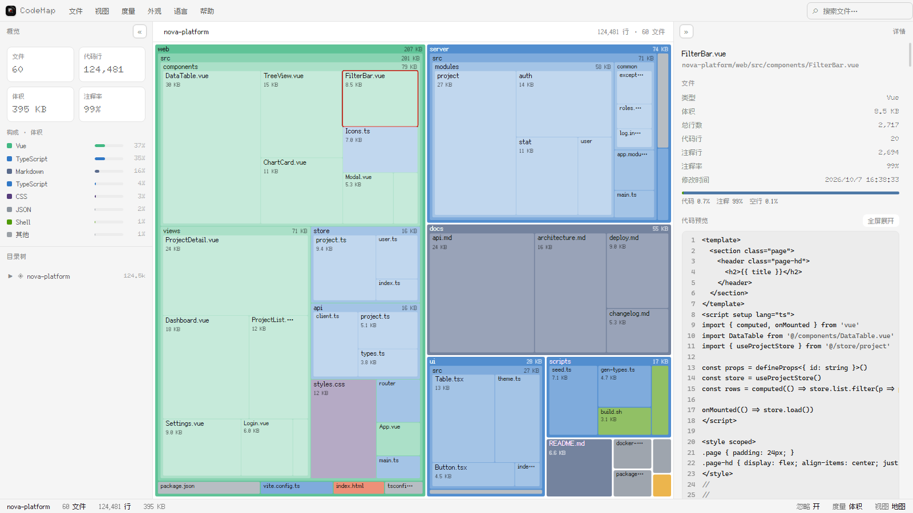

# CodeMap · 代码地图

> 把任意本地代码目录渲染成一张**可下钻的矩形地图**：面积代表体量，颜色代表语言。

<p>
  
  
  
  
  
</p>



---

## 目录

- [1. 这是什么](#1-这是什么)
- [2. 核心特性](#2-核心特性)
- [3. 下载与运行](#3-下载与运行)
- [4. 五分钟上手](#4-五分钟上手)
- [5. 文档](#5-文档)
- [6. 从源码构建](#6-从源码构建)
- [7. 项目结构](#7-项目结构)
- [8. 技术实现](#8-技术实现)
- [9. 隐私与安全](#9-隐私与安全)
- [10. 已知限制](#10-已知限制)
- [11. 许可](#11-许可)
- [12. 致谢](#12-致谢)

---

## 1. 这是什么

接手一个陌生项目时，第一件想弄清楚的事通常是：**东西都在哪、哪块最重、哪些是空壳**。
逐层翻目录树很慢，`du` / `cloc` 只给数字，看不出结构。

CodeMap 把一个目录**一次性铺成一张地图**：

| 视觉编码 | 含义 |
|---|---|
| 矩形面积 | 该文件 / 目录的体量（可在三种度量间切换） |
| 矩形颜色 | 编程语言（60+ 种语言、67 个扩展名映射，7 套配色方案） |
| 嵌套层次 | 目录结构，可逐层下钻 |
| 颜色深浅 | 嵌套深度（越深越淡，用于区分层级） |

它不是代码分析器，也不是文件管理器——定位是**结构概览**：几秒之内看清一个项目的形状，再决定深入哪里。

## 2. 核心特性

| 能力 | 说明 |
|---|---|
| **三种度量** | 代码行 / 体积 / 文件数，随时切换，同一张图换一种"重量" |
| **双视图** | 可下钻的地图；带排序的列表（7 列，点表头切换排序列与方向） |
| **全树搜索** | 扁平索引 + 表达式语法，语义对齐 voidtools Everything：`ext:` `path:` `size:` `dm:` `!` `\|` `*` `""` |
| **内置预览** | 代码高亮 / 图片 / 音视频 / PDF / CSV 表格 / 二进制十六进制 |
| **Office 解析** | docx（段落 + 表格）、xlsx（多工作表表格）、pptx（按页）直接解压渲染，无需安装 Office |
| **压缩包浏览** | ZIP 列出清单，条目可点开预览（文本走语法高亮，其他走十六进制） |
| **多语言** | 简体中文、繁體中文、English、日本語；支持导入自定义语言包 |
| **外观** | 7 套皮肤 × 7 套语言配色 × 自定义强调色 |
| **可调参数** | 格子上限、嵌套深度、列表上限、预览阈值、十六进制上限、自定义忽略目录 |
| **零依赖** | 不联网、不调用外部命令、不依赖第三方运行库 |

## 3. 下载与运行

到本仓库的 **Releases** 页面下载 `CodeMap.exe`（约 0.87 MB），**双击即可，免安装**。

| 项目 | 要求 |
|---|---|
| 操作系统 | Windows 10 / 11（x64） |
| 运行时 | WebView2 Runtime（Windows 11 与多数 Windows 10 已预装；若提示缺失，从[微软官网](https://developer.microsoft.com/microsoft-edge/webview2/)安装） |
| 安装步骤 | 无 —— 单文件，放到任意目录即可运行 |

**卸载**：直接删除 exe。残留数据位于 `%LOCALAPPDATA%\CodeMap\`（缓存的页面副本与诊断日志），可一并删除。

## 4. 五分钟上手

1. 双击 `CodeMap.exe`。首次启动会让选择界面语言与字体。
2. 点左上角 **「打开文件夹」**（或把文件夹直接拖进窗口），选择任意代码目录。
3. 等待扫描完成——地图出现：每个矩形是一个文件，颜色代表语言，面积代表体量。
4. **单击**任意块查看右侧详情；**双击**进入该目录；顶部面包屑可返回上层。
5. 顶部菜单 **「度量」** 切换：代码行 ↔ 体积 ↔ 文件数。
6. 按 `Ctrl+F` 输入关键词；也可以直接试 `ext:ts !test` —— 搜索覆盖整棵树，不只是当前层。
7. 菜单 **「视图 → 偏好」** 调整格子密度、预览上限、额外忽略目录。

完整功能说明见 **[使用手册](docs/USAGE.md)**。

## 5. 文档

| 文档 | 内容 |
|---|---|
| **[docs/USAGE.md](docs/USAGE.md)** | **完整使用手册**：功能逐项说明、搜索语法全表、预览格式矩阵、参数详解、故障排查 |
| [THIRD-PARTY.md](THIRD-PARTY.md) | 第三方组件与许可声明（含内嵌字体） |
| [LICENSE](LICENSE) | MIT 许可证 |

## 6. 从源码构建

| 依赖 | 用途 | 说明 |
|---|---|---|
| Visual Studio 2022 / 2026，含「使用 C++ 的桌面开发」 | `cl.exe`、Windows SDK | 脚本自动定位（优先 `VSINSTALLDIR`，其次 `vswhere`） |
| Python 3.9+ | 运行构建脚本 | |
| WebView2 SDK（NuGet 包） | 头文件与静态库 | 需手动放入 `build/webview2/`，**未随仓库分发** |

**① 获取 WebView2 SDK**

```bat
nuget install Microsoft.Web.WebView2 -OutputDirectory build\tmp
```

把 `build\tmp\Microsoft.Web.WebView2.*\` 里的内容整体移到 `build\webview2\`（该目录下应能看到 `build\native\include` 与 `build\native\x64`）。

> 没有 `nuget` 时，可直接从 [nuget.org 的 WebView2 页面](https://www.nuget.org/packages/Microsoft.Web.WebView2) 下载 `.nupkg`
> 文件（把它改名为 `.zip` 后解压，其余步骤同上）。

**② 构建**

```bat
python build-exe.py
```

产物：`build\CodeMap.exe`（约 0.87 MB）。静态链接 `WebView2LoaderStatic.lib`，**不依赖任何外部 DLL**。

> 页面本体 `CodeMap-source/CodeMap.html` 是单文件应用，**可直接用浏览器打开调试**，无需构建；
> 但浏览器环境缺少本机绝对路径回填与窗口控件，仅适合调界面。

## 7. 项目结构

```
CodeMap-source/
  CodeMap.html      单文件应用本体（HTML + CSS + JS + 内嵌字体，约 596 KB）
  CodeMap.ico       应用图标源文件（9 种尺寸）
build/
  CodeMap.cpp       Win32 + WebView2 宿主源码
build-exe.py        构建脚本：编译资源 → 链接 → 内嵌 HTML → 单文件 exe
i18n-tools/         词典生成与像素字体子集化工具（维护用）
docs/
  USAGE.md          完整使用手册
  screenshot.png    界面截图
Nothing-Art-Demo.html   Nothing 设计语言的美术演示页（独立单页，与主程序无关）
```

## 8. 技术实现

| 层 | 选型 | 说明 |
|---|---|---|
| 宿主 | C++ / 原生 Win32 + WebView2 | 静态链接 `WebView2LoaderStatic.lib`，输出单文件 exe |
| 窗口 | 无边框 + `DwmExtendFrameIntoClientArea` | 页面顶栏 38 px 即标题栏，窗口控件由页面绘制 |
| 前端 | 原生 HTML / CSS / JavaScript | 无框架、无构建工具、无 CDN |
| 可视化 | 手写 squarified treemap | 直接操作 SVG DOM，未使用 D3 |
| 文件访问 | File System Access API；`webkitdirectory` 为降级通道 | 适配 `file://` 下的权限限制 |
| 文档解析 | 自实现 ZIP 中央目录解析 + `DecompressionStream('deflate-raw')` | 用于 docx / xlsx / pptx / zip |
| 搜索 | 自研查询解析器 + 全树扁平索引 | 语法语义对齐 voidtools Everything |
| 存储 | `localStorage` | 偏好、语言包、面板宽度 |
| 字体 | Fusion Pixel Font（OFL-1.1）+ Doto 子集 | 内嵌为 base64 woff2，见 [THIRD-PARTY.md](THIRD-PARTY.md) |

**体积构成**：exe 0.87 MB ≈ 应用本体 0.58 MB + 宿主与资源 0.29 MB。同等功能的 Electron 方案通常约 200 MB。

## 9. 隐私与安全

- **全程本地**：不发起任何网络请求，不使用 CDN，不加载远程资源。
- **无遥测**：不收集、不上传任何使用数据。
- **无外部进程**：不调用命令行工具，不启动后台服务，不写注册表。
- **只读**：不修改、不移动、不删除被分析的任何文件。
- **诊断日志**：仅在本机 `%LOCALAPPDATA%\CodeMap\diagnostic.log` 记录启动与错误信息；超过 1 MB 自动截断，可直接删除。

## 10. 已知限制

| 限制 | 说明 |
|---|---|
| 仅索引已载入的目录 | 不是全盘索引（与 Everything 不同），需先选择项目根目录 |
| 预览不含版式 | docx / xlsx / pptx 提取文字与表格，**不还原样式、图片、分页** |
| 大文件不统计行数 | 超过 2.5 MB 的文件只计体积，代码行显示"未统计"（阈值可在偏好中调整） |
| 搜索语法差异 | `regex:` 使用 JavaScript 正则，与 Everything 的 PCRE 存在细微差异 |
| PDF 依赖系统组件 | 依赖 WebView2 内置 PDF 阅读器；若被组策略禁用则显示空白 |
| 不记忆窗口尺寸 | 每次启动使用默认窗口大小与位置 |

更细的边界与行为见 [使用手册 · 已知限制](docs/USAGE.md)。

## 11. 许可

代码以 [MIT 许可证](LICENSE) 发布。
内嵌字体属 OFL-1.1 许可的第三方资源，详见 [THIRD-PARTY.md](THIRD-PARTY.md)。

## 12. 致谢

- [voidtools Everything](https://www.voidtools.com/)（David Carpenter）—— 搜索查询语法的语义参考。
  该软件免费但**源代码未公开**；本项目仅对齐其用户可见的查询语法，搜索内核为独立实现，未使用其任何代码。
- [Fusion Pixel Font](https://github.com/TakWolf/fusion-pixel-font)、[Doto](https://fonts.google.com/specimen/Doto) —— 像素字体。
